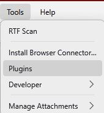
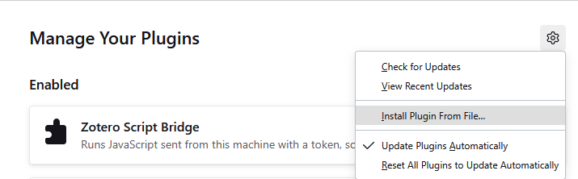

# Zotero Script Bridge


[](LICENSE)
[](https://github.com/miguelppais/zotero-script-bridge/releases/latest)


Let scripts and coding agents on your own computer organise your Zotero library.

- **What it does:** it runs JavaScript sent from your computer inside your running Zotero, for filing, moving, merging and trashing items in bulk. See [What this plugin opens up](#what-this-plugin-opens-up).
- **Install:** download the `.xpi` from the latest release and install it from Tools > Plugins. See [Install](#install).
- **Use:** start with `--ping`, then run a script file with the Python client. See [Usage](#usage).
- **Agent skill:** `npx skills add miguelppais/zotero-script-bridge` installs the skill and the client for a coding agent. See [Use from coding agents](#use-from-coding-agents).

Zotero Script Bridge is a plugin for Zotero 7 to 10 that lets scripts and coding agents on your own computer run JavaScript inside your running Zotero, the same JavaScript you would paste into Tools > Developer > Run JavaScript. It is meant for organising a library in bulk: filing items into collections, moving attachments, merging duplicates, attaching files, trashing items.

A small command-line client, `client/zotero_script_bridge.py`, sends a script file or a line of code to the plugin and prints the result.

**A script run through the bridge has full access to your whole library and to everything Zotero can reach.** Read [What this plugin opens up](#what-this-plugin-opens-up) and [Responsibility](#responsibility) before you install it, and back up your Zotero data folder before you run anything that changes the library.

The project is at an early stage (version 0.x). The version history is in [CHANGELOG.md](CHANGELOG.md).

## Install

1. Download `zotero-script-bridge-<version>.xpi` from the latest release on the Releases page of this repository.
2. Check the file's SHA-256 against the one in the release notes. On Windows run `certutil -hashfile zotero-script-bridge-<version>.xpi SHA256`, on macOS `shasum -a 256 zotero-script-bridge-<version>.xpi`, on Linux `sha256sum zotero-script-bridge-<version>.xpi`. The two values must match. If they do not, do not install the file.
3. In Zotero, choose Tools > Plugins, click the gear icon, choose Install Plugin From File, and select the `.xpi`.

   

   

   These screenshots show Zotero 10 on Windows. The menus may differ on other systems and versions.

4. In testing, Zotero did not ask for a restart. Check that the plugin is listed in Tools > Plugins.
5. The plugin writes a token to `~/.zotero-script-bridge/token` (`~` is your home folder). It makes a new token each time Zotero starts, and removes the file when Zotero closes.

### Updating

Installed copies check the repository's GitHub releases for a new version. Until the first release is published, the check finds nothing. Zotero updates installed plugins automatically by default. To review each update before it installs, untick "Update Plugins Automatically" in the gear menu in Tools > Plugins, shown ticked in the second screenshot under [Install](#install).

You can also install an update by hand, the same way as the first install. Installing the new version over the old one is the recommended route, but it has not been tested yet, and neither has whether it needs a restart. As a precaution, do not remove the old version first; if you did, restart Zotero before installing again.

### Uninstalling

Remove the plugin in Tools > Plugins. Removing it deletes the token file, and the token folder if nothing else is in it.

A pre-release copy numbered 0.1.0 kept its token in the Zotero preference `extensions.zotero-script-bridge.token` and left it behind. The current version clears that preference when it starts and when it is removed. If you removed the old copy without installing this one, delete the preference in Zotero's Config Editor.

### Building from source

<details>
<summary>Build the .xpi yourself</summary>

Clone the repository and run `python scripts/build_xpi.py` (on Windows the launcher is `py`). It writes `dist/zotero-script-bridge-<version>.xpi` and prints its SHA-256. The entries in the archive are stored without compression, so the same source tree gives the same bytes. Two builds on one machine gave identical files; other machines should too, but that was not tested.

</details>

## Usage

The client needs Python 3.11 or newer and nothing else. It is a single file that uses only the standard library, so you can copy it anywhere. The tests were run on Python 3.14. The commands below say `python`; on Windows the launcher is `py`.

Start with `--ping`, which prints Zotero's version. Zotero must be running with the plugin installed.

```bash
python client/zotero_script_bridge.py --ping
```

Run a script file, or a line of code:

```bash
python client/zotero_script_bridge.py my_script.js
python client/zotero_script_bridge.py --code "return (await Zotero.Items.getAll(Zotero.Libraries.userLibraryID)).length;"
```

The code runs as the body of an async function with `Zotero` in scope: `await` works, and `return` sets the result. A script written for the Run JavaScript window runs unchanged. The client prints the result as text if it is a string, and as JSON otherwise.

Options and settings:

- `--timeout SECONDS` sets how long to wait, above 0 and at most 86 400 (default 600).
- `--raw` prints the result as it is. Without it, control characters and characters that reorder or hide text are shown as `\xNN` or `\uNNNN` escapes, so a reply cannot disguise itself or drive your terminal. Use `--raw` only when a program reads the output.
- `ZOTERO_SCRIPT_BRIDGE_TOKEN_FILE` points the client at another token file.
- The port, 23119, is fixed in the client. The plugin only starts the bridge when Zotero's server listens on that port.

### Examples

The `examples/` folder holds scripts for everyday tasks. Each file starts with a header that says what it does, whether it writes, what to edit, and whether it has been checked on a live Zotero. Edit the constants at the top of a script before you run it; a script that still says `CHANGE ME` stops without doing anything.

A script that writes to the library defaults to a dry run: `DRY_RUN` is `true`, so it changes nothing and returns what it would change. For a write script, edit two things: the scope constant that names the collection (and the other values the header lists), and `DRY_RUN`. Run it once as it is, read the dry result, back up your Zotero data folder, and only then set `DRY_RUN` to `false` and run it again. Write scripts check each item again just before they change it and return the values as they were. Items and collections go only to the Zotero trash, where you can restore them. Tag changes cannot be recovered from the trash, because tags have no trash, but the result lists each item's tags as they were before. Moving items out of a collection is undone by moving them back.

<details>
<summary>Two example scripts in full, and the other examples in the folder</summary>

This script counts the items in one collection. It only reads. Both scripts below were checked on a live Zotero (10.0.8) on 2026-11-10.

```bash
python client/zotero_script_bridge.py examples/count-collection-items.js
```

```javascript
/*
 * Count the items in one collection, by item type, and optionally list them.
 *
 * Writes:      no, read-only.
 * Edit:        COLLECTION_NAME (the collection's exact name), and if you like
 *              INCLUDE_SUBCOLLECTIONS and LIST_ITEMS.
 * Status:      Live-checked 2026-11-10 on Zotero 10.0.8
 *
 * The bridge runs this file as the body of an async function with `Zotero` in
 * scope; whatever it returns is printed by the client.
 */

// ---- Edit these -----------------------------------------------------------
const COLLECTION_NAME = "CHANGE ME";
const INCLUDE_SUBCOLLECTIONS = false; // true also counts the collection's sub-collections
const LIST_ITEMS = false;             // true adds a short line per item to the result
const MAX_LISTED = 200;               // a long list is cut here, so the reply stays small
// ---------------------------------------------------------------------------

const PLACEHOLDER = "CHANGE ME";
if (typeof COLLECTION_NAME !== "string" || COLLECTION_NAME.trim() === "" || COLLECTION_NAME.trim() === PLACEHOLDER) {
  throw new Error(`COLLECTION_NAME is empty or still "${PLACEHOLDER}". Edit it at the top of this script.`);
}

// Two collections can share a name; stopping is safer than counting the wrong one.
const wanted = COLLECTION_NAME.trim();
// The second argument, true, makes the search include sub-collections.
const matches = Zotero.Collections.getByLibrary(Zotero.Libraries.userLibraryID, true)
  .filter(c => !c.deleted && c.name === wanted);
if (matches.length !== 1) {
  throw new Error(`${matches.length} collections are named "${wanted}"; expected exactly one.`);
}
const collection = matches[0];

const collections = [collection];
if (INCLUDE_SUBCOLLECTIONS) {
  for (const d of collection.getDescendents(false, "collection")) {
    collections.push(Zotero.Collections.get(d.id));
  }
}

// An item can sit in several of the collections; count it once.
const items = new Map();
for (const c of collections) {
  for (const item of c.getChildItems(false, false)) {
    if (!item.deleted) items.set(item.id, item);
  }
}

const byType = {};
const regular = [];
for (const item of items.values()) {
  const type = Zotero.ItemTypes.getName(item.itemTypeID);
  byType[type] = (byType[type] || 0) + 1;
  if (item.isRegularItem()) regular.push(item);
}

const result = {
  collection: wanted,
  includesSubcollections: INCLUDE_SUBCOLLECTIONS,
  totalItems: items.size,
  regularItems: regular.length,
  byType,
};

if (LIST_ITEMS) {
  result.listed = regular.slice(0, MAX_LISTED).map(item => ({
    key: item.key,
    title: item.getDisplayTitle(),
    year: Zotero.Date.strToDate(item.getField("date")).year || null,
  }));
  result.listCutAt = regular.length > MAX_LISTED ? MAX_LISTED : null;
}
return result;
```

This script adds, removes or renames a tag on the items of one collection. It writes when `DRY_RUN` is `false`.

```bash
python client/zotero_script_bridge.py examples/bulk-tag.js
```

```javascript
/*
 * Add, remove or rename one tag on the items of one collection.
 *
 * Writes:      YES, when DRY_RUN is false. With DRY_RUN true (the default) it
 *              changes nothing and returns the items it would change.
 * Edit:        COLLECTION_NAME and TAG; ACTION ("add", "remove" or "rename");
 *              NEW_TAG for "rename". Leave DRY_RUN true until you have read the
 *              dry result, then set it to false.
 * Status:      Live-checked 2026-11-10 on Zotero 10.0.8 (a dry run, then real
 *              add, rename and remove runs on throwaway items)
 *
 * It works one item at a time and only on items in the collection. It never
 * touches the library-wide tag list, so the same tag on an item outside the
 * collection is left alone. Zotero has no trash for tags: a tag you remove is
 * gone from that item, and the result lists each item's tags as they were, so
 * you can add them back.
 *
 * "rename" adds NEW_TAG and removes TAG on each item in scope; it does not
 * rename the tag for the whole library.
 *
 * Before you set DRY_RUN to false: back up the Zotero data folder, and read the
 * dry result. Each item is checked again just before it is changed.
 *
 * The bridge runs this file as the body of an async function with `Zotero` in
 * scope; whatever it returns is printed by the client.
 */

// ---- Edit these -----------------------------------------------------------
const DRY_RUN = true;
const ACTION = "add";                 // "add", "remove" or "rename"
const COLLECTION_NAME = "CHANGE ME";
const TAG = "CHANGE ME";              // the tag to add or remove, or the old name for "rename"
const NEW_TAG = "CHANGE ME";          // only used by "rename"
const INCLUDE_SUBCOLLECTIONS = false; // true also covers the collection's sub-collections
const MAX_CHANGES = 200;              // a real run refuses to change more items than this
// ---------------------------------------------------------------------------

const PLACEHOLDER = "CHANGE ME";
function required(name, value) {
  if (typeof value !== "string" || value.trim() === "" || value.trim() === PLACEHOLDER) {
    throw new Error(`${name} is empty or still "${PLACEHOLDER}". Edit it at the top of this script. Nothing was read or changed.`);
  }
  return value.trim();
}
if (!["add", "remove", "rename"].includes(ACTION)) {
  throw new Error(`ACTION must be "add", "remove" or "rename", not ${JSON.stringify(ACTION)}. Nothing was read or changed.`);
}
const wanted = required("COLLECTION_NAME", COLLECTION_NAME);
const tag = required("TAG", TAG);
const newTag = ACTION === "rename" ? required("NEW_TAG", NEW_TAG) : null;
if (ACTION === "rename" && newTag === tag) {
  throw new Error("NEW_TAG is the same as TAG. Nothing was read or changed.");
}

// Two collections can share a name; stopping is safer than tagging in the wrong one.
// The second argument, true, makes the search include sub-collections.
const matches = Zotero.Collections.getByLibrary(Zotero.Libraries.userLibraryID, true)
  .filter(c => !c.deleted && c.name === wanted);
if (matches.length !== 1) {
  throw new Error(`${matches.length} collections are named "${wanted}"; expected exactly one. Nothing was changed.`);
}
const collection = matches[0];

const collections = [collection];
if (INCLUDE_SUBCOLLECTIONS) {
  for (const d of collection.getDescendents(false, "collection")) {
    collections.push(Zotero.Collections.get(d.id));
  }
}

// An item can sit in several of the collections; handle it once.
const scope = new Map();
for (const c of collections) {
  for (const item of c.getChildItems(false, false)) {
    if (item.isRegularItem() && !item.deleted) scope.set(item.id, item);
  }
}

// What each action needs to be true of an item before it applies.
function needsChange(item) {
  if (ACTION === "add") return !item.hasTag(tag);
  return item.hasTag(tag); // "remove" and "rename" both act on items that carry TAG
}
const inScope = item => !item.deleted && collections.some(c => item.inCollection(c.id));

const planned = [...scope.values()].filter(needsChange);
if (!DRY_RUN && planned.length > MAX_CHANGES) {
  throw new Error(`${planned.length} items would change, more than MAX_CHANGES (${MAX_CHANGES}). Nothing was changed. Raise MAX_CHANGES on purpose or narrow the collection.`);
}

const result = {
  dryRun: DRY_RUN,
  action: ACTION,
  tag,
  newTag,
  collection: wanted,
  includesSubcollections: INCLUDE_SUBCOLLECTIONS,
  itemsInScope: scope.size,
  itemsToChange: planned.length,
  changes: [],
  skipped: [],
};

for (const item of planned) {
  const change = {
    key: item.key,
    title: item.getDisplayTitle(),
    tagsBefore: item.getTags().map(t => ({ tag: t.tag, type: t.type || 0 })),
  };
  if (!DRY_RUN) {
    // The item may have changed since the scan; re-check before touching it.
    if (!inScope(item) || !needsChange(item)) {
      result.skipped.push({ key: item.key, reason: "changed since the scan; left alone" });
      continue;
    }
    if (ACTION === "add") {
      item.addTag(tag, 0);
    } else if (ACTION === "remove") {
      item.removeTag(tag);
    } else {
      const type = item.getTagType(tag) || 0; // keep a manual or automatic tag what it was
      item.removeTag(tag);
      item.addTag(newTag, type);
    }
    await item.saveTx();
    change.tagsAfter = item.getTags().map(t => ({ tag: t.tag, type: t.type || 0 }));
  }
  result.changes.push(change);
}
return result;
```

The other scripts in the folder, all checked on Zotero 10.0.8 on 2026-11-10:

- `items-without-pdf.js` lists the items in a collection that have no PDF attachment. Read-only.
- `items-missing-doi-or-year.js` lists the items in a collection that have no DOI, no year, or neither. Read-only.
- `collection-to-csv.js` returns chosen fields of every item in a collection as CSV text. Read-only. Run it with `--raw` and redirect the output to keep it.
- `merge-duplicates.js` finds duplicates inside a collection and merges each set into its oldest item; the others go to the trash. Writes (dry run by default). The fallback it uses on Zotero 7 to 9 was not run.
- `move-or-copy-items.js` moves or copies the items of one collection into another collection. Writes (dry run by default).
- `remove-empty-collections.js` moves the empty sub-collections of one collection to the trash. Writes (dry run by default).

</details>

### Replies and exit codes

The plugin answers with JSON: `{"ok": true, "result": ...}` when the script returned, or `{"ok": false, "error": "...", "stack": "..."}` when it threw. The client prints the result, or the error and stack, and sets its exit code:

| Exit code | Meaning |
| --- | --- |
| 0 | The script returned. |
| 1 | The script threw. The error and stack are printed. |
| 2 | The client did not send anything: bad arguments (including a `--timeout` outside its range), a script file that is missing, unreadable or not a regular file, a token file that is missing, empty, over 4 KiB, not a regular file or unreadable, or script text that cannot be encoded as UTF-8. |
| 3 | Zotero or the plugin is not reachable, or the reply was not the bridge's (a redirect, a reply of the wrong shape, an HTTP error status the plugin does not send, a reply body over 64 MiB), or no complete reply came within `--timeout` plus 2 seconds, or the connection failed after the script was sent (the script may have run), or stdout could not be written (the script has run; only its output was lost), or the client failed unexpectedly (the script may have run). |
| 4 | The bridge refused the request: token, origin or host. |
| 5 | The bridge rejected the request: an empty script, a script over 1 048 576 bytes, or a wrong content type. |
| 130 | Interrupted with Ctrl+C. The script may still be running in Zotero. |

With Zotero closed, the client normally exits 2 ("no token file"), because the plugin removes the token file when Zotero closes.

### Calling the endpoint directly

<details>
<summary>The raw HTTP request and reply</summary>

```text
POST http://127.0.0.1:23119/script-bridge/execute
Content-Type: text/plain
X-Script-Bridge-Token: <contents of the token file>

<JavaScript>
```

The reply is the JSON described above. The token changes on every Zotero start, so read the token file on each call instead of keeping a copy.

</details>

### Use from coding agents

A coding agent can call the client, read its exit code and output, and act on them. The repository ships an agent skill, [skills/zotero-script-bridge/SKILL.md](skills/zotero-script-bridge/SKILL.md), that teaches an agent how to run scripts, read replies and exit codes, and how to write to a library with safeguards. The skill folder also holds a copy of the client, so an agent that installs the skill has the client too.

**Install with `npx`.** The [`skills` command-line tool](https://github.com/vercel-labs/skills) installs the `skills/zotero-script-bridge/` folder, the `SKILL.md` file and the client together, for the coding agent you choose. It does not install the plugin, which still comes from the `.xpi` (see [Install](#install)). It needs Node.js 22.20 or later.

```bash
# Asks which agent to install for. The default scope is the current project folder.
npx skills add miguelppais/zotero-script-bridge

# No questions: Claude Code, this project only, as a plain copy.
npx skills add miguelppais/zotero-script-bridge -a claude-code -s zotero-script-bridge --copy -y
```

- Add `-g` to install for your user account, so every project sees it, instead of the current project.
- `-a` picks another agent. Run `npx skills add miguelppais/zotero-script-bridge -l` to list what the tool finds without installing anything.
- The tool sends anonymous usage data to skills.sh, which lists repositories by install count. To turn that off, set `DISABLE_TELEMETRY=1` in the environment first: `DISABLE_TELEMETRY=1 npx skills add ...` in a Unix shell, or `$env:DISABLE_TELEMETRY = "1"` in PowerShell.
- In a project that has no `.claude` folder yet, create the folder first. Otherwise the tool can skip Claude Code and leave the skill only in the shared `.agents` folder.
- Without a version, the command installs the repository's current files from its default branch, not a release. The skill's client can therefore be newer than the plugin you installed.
- The install was tested on 2026-11-10 from a local export of this repository, not from GitHub. The skill folder then held `SKILL.md` and a byte-identical copy of the client, and that copy's `--ping` returned the Zotero version. The command as written above, run against GitHub, will first be checked at the first release. After any install, check that the skill folder holds both `SKILL.md` and `zotero_script_bridge.py`.
- The tool also writes a `skills-lock.json` file at the root of the project folder. It records where the skill came from and how it was copied.

**Or copy the folder by hand.** Copy the whole `skills/zotero-script-bridge/` folder from a clone of this repository into your agent's skills folder. Take the folder, not just `SKILL.md`: the client is in it.

**A script gets full access to the whole library and to everything Zotero can reach. Back up your Zotero data folder, and try scripts on a backup first.**

### Running the tests

<details>
<summary>How to run the tests</summary>

```bash
python -m unittest discover -s tests
```

The tests cover the client and the scripts. They never talk to a real Zotero. [CONTRIBUTING.md](CONTRIBUTING.md) has the rest of the developer setup.

</details>

## Responsibility

The bridge runs arbitrary code with full access to your library.

You are responsible for your library in every case, with or without the skill. If you use agents or scripts without the skill, or ignore its safeguards, that is entirely your own responsibility.

The skill's safeguards are the recommended practice for agents. They are advice, not a guarantee.

The software is provided as is, under the MIT licence, and the author is not liable for data loss or damage. See [LICENSE](LICENSE). This section is plain-language advice, not legal advice; the licence text is what counts.

Keep a backup.

## Tested on

Tested on Windows only, with Zotero sync off; not tested with sync on.

In detail:

- Windows 11, with Zotero 10.0.7 and 10.0.8.
- The plugin's manifest accepts Zotero 7 to 10, but Zotero 7, 8 and 9 were never run.
- macOS and Linux were never run. That includes the code that sets the token file's permissions.
- Every live check ran with Zotero sync off.

### Sync

The bridge changes the local Zotero database through the running Zotero app, unlike tools that work through the Zotero web API, so it works with cloud sync turned off. If sync is on, local changes sync to the cloud as any edit made in the app would, so a mistake in a batch reaches the cloud and your other devices too. How the bridge behaves with sync on has not been tested.

## What this plugin opens up

Read this before installing. It describes the plugin's code. Where a statement rests on reading Zotero's or the plugin's source and was not run, it says so.

**What it exposes.** Installing the plugin adds one endpoint, `POST /script-bridge/execute`, to Zotero's local server on `127.0.0.1:23119`. A request that passes the guards below runs its body as JavaScript in Zotero's privileged scope, with the same rights as Zotero itself: every item, collection, note and attachment in every library, the files Zotero can read and write, and anything else that scope can reach on your computer. There is no sandbox, no read-only mode and no list of what a script may do. The plugin keeps no log of the scripts it runs (it logs only a script that throws). A script can also register endpoints of its own or replace this one.

**Who can use it.** Any program that can read the token file `~/.zotero-script-bridge/token` in your home folder and connect to `127.0.0.1:23119`. That includes every program you run under your account without a sandbox: such a program can also read Zotero's preferences or change your Zotero profile, so the token is no barrier to it. The token keeps out web pages, other user accounts and programs that run in a sandbox without access to your home folder. It does not keep out ordinary programs run by you.

**What a mistake costs.** A script that deletes or merges items does so in your real library. Back up your Zotero data folder before you run batch scripts.

**What the guards are for, and what they are not.** The guards are meant to stop web pages and programs that do not hold the token. They do not limit what a script with the token may do. Anything that can read the token file owns your Zotero library and can act as you.

### Before any request

The plugin starts the bridge only when Zotero's server listens on port 23119, the port the bundled client uses. On another port it logs one error, writes no token file and registers no endpoint.

### Guards, in the order the plugin applies them

A request must pass every guard. Each one that refuses answers with the status code shown and does not run the script.

1. **Origin header present: 403.** Meant to refuse web pages. This refusal has never been exercised: Zotero's own server drops any request carrying an `Origin` header, or a browser User-Agent, before the plugin runs (the connection is closed with no response), so the plugin's 403 for it has not been seen.
2. **Host header must be `127.0.0.1:<port>` or `localhost:<port>`: 403.** The port is the one Zotero's server is actually listening on. Meant to stop DNS rebinding. Zotero answers 400 first to most other hosts: its HTTP layer for an HTTP/1.1 request with a wrong Host, and its server code for an HTTP/1.0 request with another hostname or none. In the cases measured (Zotero 10.0.7, requests sent without a token), only an HTTP/1.0 request with a wrong port, `[::1]`, or `localhost` without a port reached this check. Browsers send HTTP/1.1 or newer. Whether every rebinding path is stopped by these layers together is not established.
3. **`X-Script-Bridge-Token` header must equal the token: 403.** The plugin makes the token from 32 random bytes of the platform's random number generator, on every Zotero start. It holds the token in memory and in the token file, not in a Zotero preference, so a script cannot read it back through Zotero's preferences. The comparison takes the same time for any token of the right length. A missing or wrong token gets 403. A copy of the token taken from a backup, a log or another program stops working at the next Zotero start. The plugin removes the token file when Zotero closes; if Zotero crashes the file stays until the next start replaces it.
4. **Content-Type must be `text/plain`, with or without parameters: 415.** A request that carries a different type never reaches this check: Zotero's server answers 400 itself, before the token check. A request with no `Content-Type`, or an empty one, gets this 415 after the token check.
5. **Empty or whitespace-only body: 400.**
6. **Body over 1 048 576 bytes of UTF-8: 413.** The script is not compiled or run. It is refused only after Zotero's server has already read the whole body into memory (read in Zotero 10.0.7 source, not exercised), so this limits what runs, not what arrives.
7. **Token file permissions.** This is not a per-request check. It runs once when Zotero starts and only limits who can read the token. On macOS and Linux the plugin sets the folder to mode 0700 and the file to 0600, and if that fails it stops and registers no endpoint. This code has not been run on macOS or Linux. On Windows the plugin does not change the permissions: the folder and file keep the access list they inherit from your home folder. The call that would restrict them has no effect on Windows, so this was a decision, not an oversight. On the one default Windows 11 profile checked, that list names only the system, administrators and the owner, but a home folder that grants more passes it on to the token file.

A script that passes all of this runs. A script that throws gets a 500 with its stack. If the script ran but its result cannot be turned into JSON, the reply is a 500 that says so; the script's effects have already happened.

### What the guards do not cover

- Another program on port 23119. The client cannot tell Zotero from another program that listens on that port, and it sends the token and the script to whatever answers. A token captured while Zotero is closed is dead after the next start, so such a program cannot reuse it later. But replies are not authenticated: a program that holds the port can read a script and fake its result. A way for the client to confirm it is talking to Zotero is not built. The client ignores proxy settings and never follows a redirect, so the token and the script go only to `127.0.0.1`.
- Programs run by you. As described under Who can use it, a program that runs as you, without a sandbox, can read the token and act as you.
- The Windows token folder. On Windows the plugin does not check who owns the token folder and does not set its permissions. It inherits them from your home folder, which on a default profile is owner-only. On a machine whose home folder lets other accounts create folders, another account could prepare the token folder in advance and read the token. The author chose to accept this rather than run an external program to change the access list.
- Debug output. Zotero's debug output may record request headers, including the token. It was checked once at log level 3 with one `--ping` sent, and the header was not logged. Higher levels were not checked. Restart Zotero before you share debug output that was recorded while the bridge was running; the old token is useless after a restart.
- A large body from a caller without the token. Zotero's server and its HTTP layer read the whole body before the plugin's guards run, and put no cap on its length. The plugin only gets control after that read, so it cannot limit what arrives (read in Zotero 10.0.7 source, not exercised).
- Content types. A caller without the token can learn which content types are accepted, because Zotero's 400 for a wrong type comes before the token check.
- The Host check and the Origin refusal. What reaches the Host check, and whether every rebinding path is stopped, is described under guard 2. The Origin refusal has never been seen to run, as described under guard 1.
- Status lines. The 413 and 415 replies have no proper reason phrase (`413` with nothing after it, `415 undefined`). This is cosmetic: the status code and the JSON body are correct. Fixing it would mean changing a table in Zotero's server that every endpoint shares, and the author chose not to.
- Two Zotero profiles running at once. They overwrite each other's token file, so the other profile's calls are refused.
- The Host check is not a check of where the request came from. If Zotero's server ever listened beyond the local machine, the token would be the only guard.
- Ctrl+C on Windows. It can take up to `--timeout` plus 2 seconds to stop the client.
- Building from source on Windows. A file swapped for a link between the build's check and its read would be followed.
- Updates. Installed copies check the repository's GitHub releases, and the `updates.json` file is not signed. Whoever can publish a release there controls what installed copies update to, and can ship code that runs inside your Zotero, so installing the plugin trusts that release process.
- The skill install command. `npx skills add miguelppais/zotero-script-bridge` installs the repository's current files from its default branch, not a release. Whoever can push to that branch controls the client and the skill the command installs, beside the release trust described under Updates. An agent that follows the installed skill runs the installed client with its own permissions.

### Review

The plugin, the client and the build script were reviewed for security by an AI agent that was given only that code, with no notes from the project. It was not a human audit. Changes made after that review were checked the same way. Its findings were fixed, apart from the limits listed above under What the guards do not cover. If you find a way around a guard, report it as described in [SECURITY.md](SECURITY.md).

## Contributing, security reports and licence

- [CONTRIBUTING.md](CONTRIBUTING.md): issues and pull requests are welcome.
- [SECURITY.md](SECURITY.md): report a vulnerability privately, not in a public issue.
- [CHANGELOG.md](CHANGELOG.md): what changed in each version.
- [LICENSE](LICENSE): MIT.
